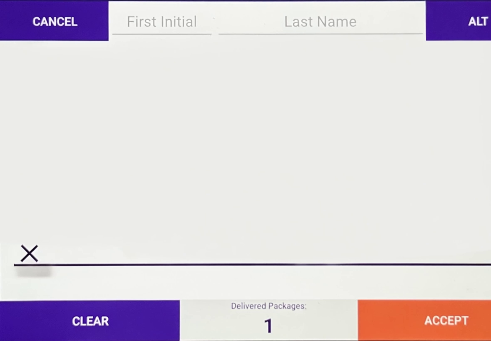
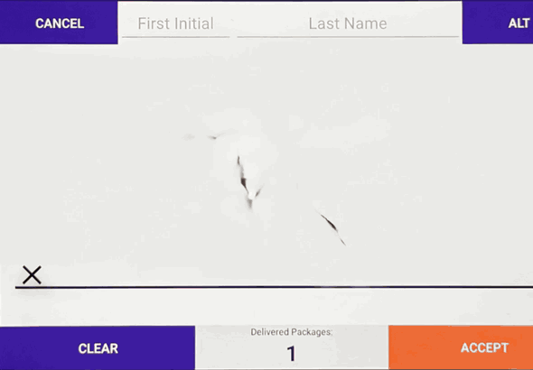

# Signature jumpscare

This page emulates a delivery signature form, with a special surprise. Once the victim begins signing, a short delay triggers a jumpscare video—a surprise for the signer and everyone watching.

Originally built for an **iPad Air M2** running [Kiosker](https://kiosker.io/).

The page is plain HTML, CSS, and JavaScript. Any static webserver can host it. No backend, npm installation, or build step is needed to run the supplied files. Signatures stay in memory and are never saved or uploaded.

## Preview

**Signing form**



**Jumpscare video**



## Browser support

These results reflect testing on the iPad Air M2:

| Browser | Result |
| --- | --- |
| Kiosker | Works correctly; recommended for fullscreen kiosk use. |
| Safari, windowed | Works correctly. |
| Safari, fullscreen | Works, with a brief frame-sizing glitch on repeated plays. |
| Brave | Does not work in the tested setup. |
| Firefox | Does not work in the tested setup. |

## How it works

1. Open your browser to the URL where you uploaded the files.
2. Sign with a finger, Apple Pencil, or mouse. The first stroke starts a **3-second countdown**.
3. The jumpscare animation plays with sound for about **4–5 seconds**.

After the animation, the form resets automatically and is ready for the next person.

## Host the page

Upload these files together into a directory on your webserver:

```text
index.html
styles.css
config.js
app.js
scaled_jumpscare_static.png
scaled_jumpscare.mp4
```

Open that directory's URL to use the page. Serve MP4 files as `video/mp4`; byte-range support is recommended. HTTPS is recommended for hosting and is required for the optional screen wake lock.

## Set up the iPad with Kiosker

Set Kiosker's **default URL** to the hosted page's address. No other Kiosker configuration is required.

## Adjust the timing

Edit `config.js`:

```js
delayMs: 3000,       // First stroke → video starts.
resetAfterMs: 7000,  // First video frame → clean form for the next person.
```

The included animation is **4.5 seconds** long. `resetAfterMs` controls when the form returns, measured from the first video frame. Adjust it independently of the clip's duration. A reset time shorter than the clip cuts playback short. Ink color and line width are also configurable.

After changing settings, upload `config.js` and reload the page in Kiosker.

## Replace the image or video

The originals are `source_jumpscare.mov` and `source_jumpscare_static.png`. The page uses `scaled_jumpscare.mp4` and `scaled_jumpscare_static.png`. You can export these files directly from your editor or use the script below.

Export the video and image at the same resolution. The supplied originals are **2360 × 1640**. Match the aspect ratio and framing, including any black bars, for the cleanest transition.

Export settings:

| Setting | Value |
| --- | --- |
| Container | MP4 |
| Video codec | H.264 |
| Resolution | Match the signing image; 2360 × 1640 for the supplied image |
| Frame rate | Keep your animation's frame rate |
| Audio codec | AAC |

If old files remain cached, change the `?v=...` value for the video URL in `config.js` and for updated script/image URLs in `index.html`, then reload Kiosker.

`source_sign_static.png` is an earlier image and is unused by the page. It does not need to be uploaded.

## Transcode the video

Requires **Python 3** and **FFmpeg**.

Convert `source_jumpscare.mov` and resize `source_jumpscare_static.png` to the same preferred resolution:

```sh
python3 prepare-media.py --width 2360 --height 1640
```

Output: `jumpscare-web.zip`, containing all the files needed to host the page.

## No HTTP server?

From the directory containing the files, run:

```sh
python3 -m http.server 8000
```

Open `http://YOUR-COMPUTER-IP:8000` in the iPad's browser on the same network.
